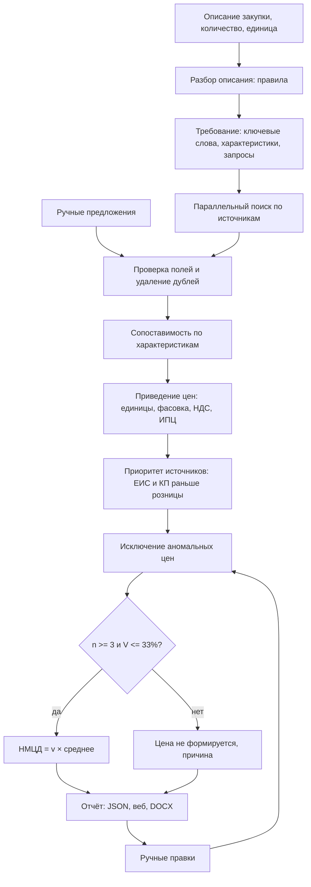

# Архитектура

## Компоненты

| Компонент | Файлы | Ответственность |
|---|---|---|
| Веб-интерфейс | `public/` | Форма закупки, ручные предложения, отчёт, ручные правки, выгрузка |
| HTTP API | `src/app.js`, `src/server.js` | Проверка входных данных, запуск расчёта, история, пересчёт, DOCX |
| Конвейер | `src/core/pipeline.js` | Порядок этапов, решения по каждому предложению, трассировка |
| Разбор описания | `src/core/requirement.js`, `text.js`, `units.js` | Наименование, характеристики, количество, единица, фасовка, запросы |
| Реестр источников | `src/sources/registry.js`, `config/sources.json` | Загрузка адаптеров по конфигурации |
| Адаптеры источников | `src/sources/<id>.js` | Запрос к источнику и разбор ответа в `RawOffer` |
| HTTP-клиент | `src/core/http.js` | Таймауты, повторы, пауза между запросами к хосту, типы ошибок, запись и воспроизведение ответов |
| Дубли | `src/core/dedupe.js` | Идентификатор, ссылка, совпадение содержания |
| Сопоставимость | `src/core/relevance.js` | Проверка характеристик, оценка 0..1, причина исключения |
| Приведение цен | `src/core/normalize.js` | Единицы, фасовка, НДС, индексация по ИПЦ |
| Расчёт | `src/core/stats.js` | Выбросы, коэффициент вариации, среднее, НМЦД, формула |
| Правила | `src/core/rules.js`, `config/rules.json` | Все пороги и допуски |
| Хранилище | `src/core/store.js` | Отчёты в `data/reports/*.json` |
| Отчёт DOCX | `src/report/docx.js` | Документ-обоснование |

## Поток данных

Каждый этап записывает решение в само предложение (`decision.stage`, `decision.code`,
`decision.reason`), поэтому отчёт содержит полный путь любого предложения от источника до расчёта
или исключения.

## Контракты данных

Структуры данных (поля перечислены ниже) передаются между модулями как обычные объекты.

- `PurchaseRequest` — вход: описание, количество, единица, ОКПД2, регион, источники, ручные предложения.
- `Requirement` — результат разбора: `subject`, `keywords`, `attributes[]` (имя, значение, число,
  единица, сравнение, существенность), `unit`, `packContent`, `searchQueries`.
- `RawOffer` — предложение как в источнике: `sourceId`, `externalId`, `url`, `title`, `priceRub`,
  `unitText`, `vat`, `characteristics`, `supplier`, `priceDate`, `fetchedAt`, `evidence`.
  Исходные данные после получения не изменяются.
- `EvaluatedOffer` — предложение в отчёте: `raw`, `price` (приведённая цена и список поправок),
  `relevance` (оценка и проверка каждой характеристики), `decision` (включено или исключено и почему).
- `Calculation` — статус, использованные предложения, статистика, формула, шаги исключения выбросов.
- `Report` — всё вместе плюс `sources[]` (результат каждого источника), `trace[]` (ход расчёта),
  `rules` (снимок правил), `overrides` (ручные правки).

## Устойчивость

| Ситуация | Поведение |
|---|---|
| Источник недоступен, таймаут, ошибка сети | `SourceError('network' / 'timeout')`, до одного повтора; источник помечается недоступным, расчёт продолжается |
| Блокировка, капча, HTTP 401/403/429 | `SourceError('blocked')`, обход не выполняется |
| Изменилась структура страницы | Адаптер бросает `SourceError('parse')` вместо пустого результата |
| В предложении нет цены, ссылки, единицы | Предложение исключается с причиной «недостаток данных» или «неподходящая единица измерения» |
| Ошибка в коде адаптера | Перехватывается конвейером, источник помечается `internal`, остальные работают |
| Источник завис | Общий лимит времени на источник (`collect.perSourceTimeoutMs`) |
| Мало данных или неоднородная выборка | Цена не формируется, в отчёте причина |
| Ошибка в `config/rules.json` | Сервис не запускается и называет неверный параметр |

## Решения

- **Детерминированный расчёт.** Цена должна воспроизводиться, поэтому и отбор предложений, и арифметика
  выполняются по явным правилам из `config/rules.json`: одинаковые входные данные дают одинаковый результат.
- **Строгость важнее полноты.** Предложение с неподтверждёнными существенными характеристиками или
  без единицы продажи в расчёт не идёт; решение можно изменить вручную, и это будет видно в отчёте.
- **Источник — модуль.** Ядро не знает о конкретных сайтах: адаптер возвращает `RawOffer[]` или
  типизированную ошибку.
- **Файловое хранилище.** Один расчёт — один JSON; этого достаточно для проверки и пересчёта и не
  требует отдельной базы данных.
- **JavaScript без сборки.** ES-модули Node.js выполняются напрямую, образ состоит из исходников и зависимостей.
